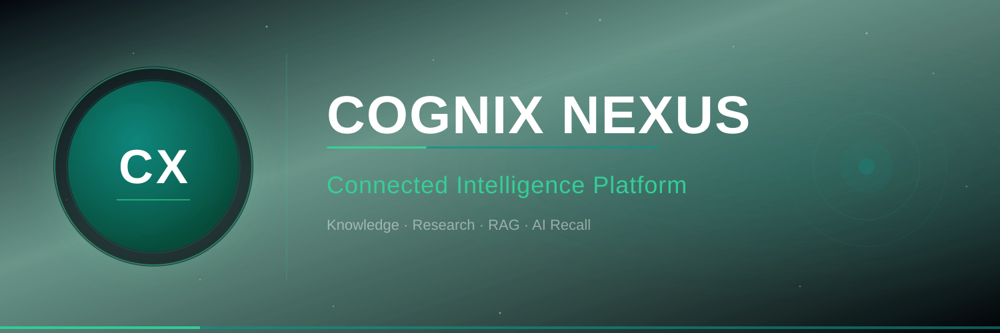

  

  
  
  
  
  
  
  

---

  <strong>An evidence-aware personal knowledge OS for research, connected ideas, hybrid retrieval, and AI-assisted active recall.</strong>

  knowledge graphs · research · RAG · AI recall

---

  
  &nbsp;
  

