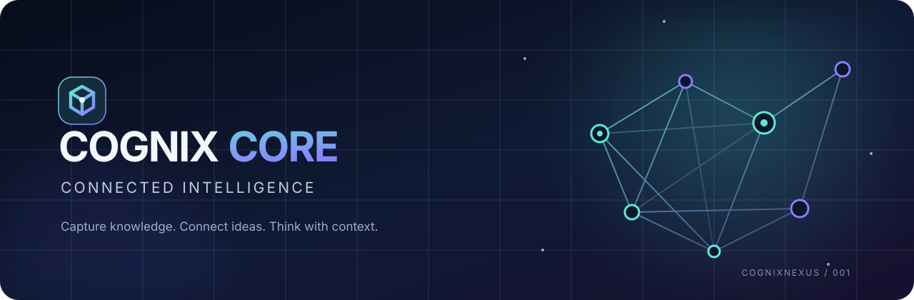

  <strong>Building a more useful, connected personal knowledge system.</strong> 
  Research intelligence · Knowledge graphs · AI-assisted recall

  <a href="https://github.com/cognixnexus/Cognix-Nexus">Explore the platform</a>
  &nbsp;·&nbsp;
  <a href="https://cognix-nexus.vercel.app">Open web app</a>
  &nbsp;·&nbsp;
  <a href="https://github.com/cognixnexus/Cognix-Nexus/issues">Issues & feedback</a>

  
  
  

---

## The Cognix vision

**Cognix Core** is the broader vision: an intelligence layer for capturing information, preserving its evidence, connecting ideas, and making useful knowledge retrievable.

**Cognix Nexus** is the platform being built around that vision.

The goal is not another place to collect links. It is a system that helps transform scattered information into knowledge that can be explored, checked, connected, and remembered.

## What we're building

| Focus | Direction |
|---|---|
| Research capture | Bring material from documents, web sources, audio, and connected channels into one workflow |
| Evidence-aware knowledge | Keep claims connected to their sources and review state |
| Connected thinking | Explore relationships between concepts and references |
| Contextual retrieval | Find relevant knowledge through semantic and structured context |
| Active recall | Support learning with flashcards and spaced repetition |
| Multi-surface access | Build web, mobile, and messaging-oriented experiences |

## Product & code

  <a href="https://github.com/cognixnexus/Cognix-Nexus"><strong>COGNIX NEXUS — MAIN REPOSITORY</strong></a>

- **Application:** [Cognix Nexus Web](https://cognix-nexus.vercel.app)
- **Backend API:** [Cognix Core API](https://cognix-core-ypak.onrender.com)
- **Source code:** [github.com/cognixnexus/Cognix-Nexus](https://github.com/cognixnexus/Cognix-Nexus)
- **Architecture:** [System overview](https://github.com/cognixnexus/Cognix-Nexus/blob/main/docs/ARCHITECTURE.md)
- **Security:** [Security policy](https://github.com/cognixnexus/Cognix-Nexus/blob/main/SECURITY.md)

## Engineering principles

- **Evidence before certainty** — preserve where information came from.
- **Human review matters** — generated claims are not automatically verified facts.
- **Connected, not complicated** — structure should make knowledge easier to use.
- **Privacy-conscious engineering** — keep credentials out of source control and handle integrations deliberately.
- **Useful intelligence** — prioritize workflows that improve understanding, recall, and action.

---

  COGNIX CORE · CONNECTED INTELLIGENCE · BUILT ITERATIVELY

